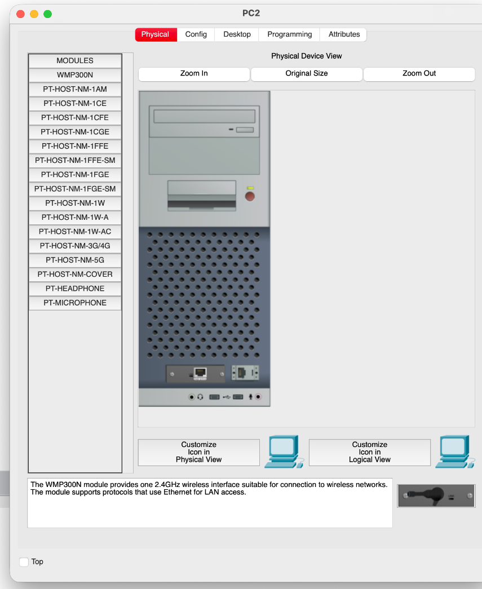
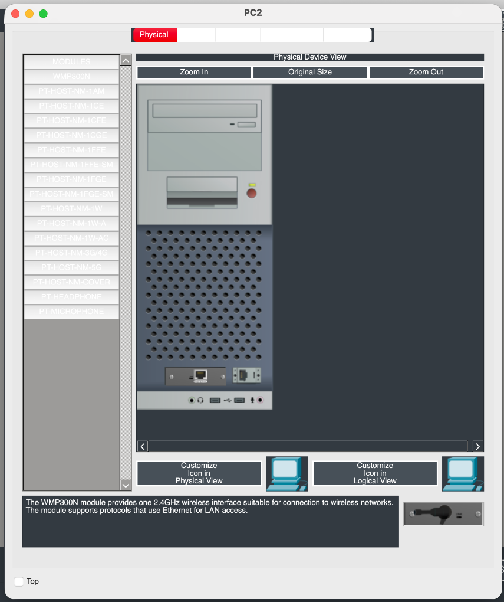

# Software Quality Assurance Portfolio

Welcome to my Software QA portfolio!

I'm a first-year Computer Science student at Anglia Ruskin University, exploring software engineering, debugging, quality assurance, test automation and AI engineering.

This repository documents software defects I've investigated, reproduction steps, testing evidence and future testing projects.

## Bug Report 001 — Cisco Packet Tracer Dark Mode

**Product:** Cisco Packet Tracer  
**Version:** 9.0.1  
**Category:** UI / Accessibility / Theme Rendering  
**Proposed severity:** Medium  
**Status:** Reproduced and documented; vendor resolution not confirmed

### Summary

When Dark Mode is enabled in Cisco Packet Tracer, certain interface elements become difficult to read due to insufficient contrast between text and background colours.

The issue is particularly noticeable in the PC Physical tab, where hardware module names appear in almost-white text against a light-grey background.

### Evidence

**Default Theme — Readable interface**

**Dark Mode — Unreadable module labels**

### Steps to Reproduce

1. Launch Cisco Packet Tracer.
2. Enable Dark Mode under Preferences.
3. Open a PC device.
4. Navigate to the Physical tab.
5. Inspect the hardware module names in the left-hand panel.

### Expected Result

All text should remain clearly readable across every available interface theme.

### Actual Result

Module names become extremely difficult to distinguish in Dark Mode. The Default and Slate themes display the labels more clearly.

### Cross-Platform Testing

The issue was observed on:

- macOS — Reproduced locally
- Ubuntu — Independently tested by another user
- Windows 11 — Observed on university computers

These observations suggest the issue is not isolated to a single operating system. Exact application versions on every test machine have not yet been independently verified.

### Suspected Cause

An inconsistency in theme-specific foreground and background colour handling.

This is a hypothesis based on visual observations, not a confirmed source-code diagnosis.

### Impact

Reduced readability makes identifying and selecting hardware modules difficult during networking exercises.

### QA Skills Demonstrated

- Defect identification
- Manual software testing
- Reproduction steps
- Cross-platform comparison
- UI and accessibility testing
- Bug documentation

---

## Future Projects

I plan to expand this portfolio with:

- Automated tests for C applications
- Input validation and edge-case testing
- Regression testing
- Python unit testing
- AI model evaluation and reliability testing

## Technical Interests

C • Python • Software Testing • Debugging • AI Engineering

---

*This is an independent student QA portfolio and is not affiliated with Cisco.*
